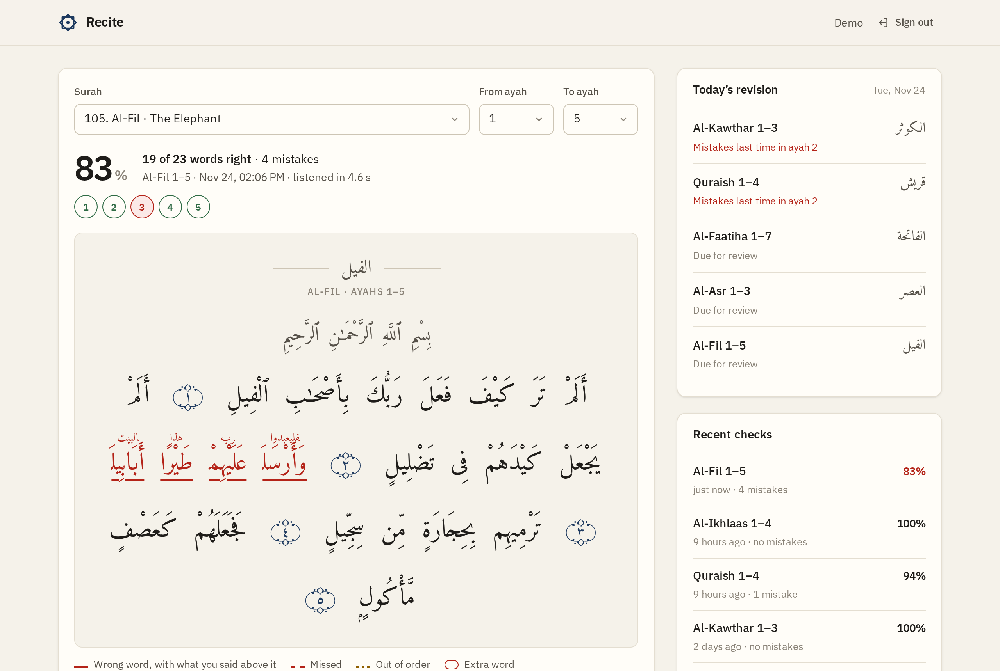
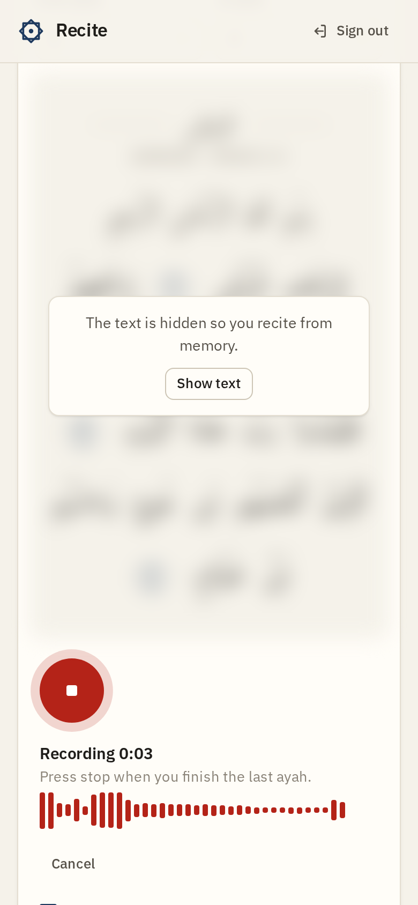
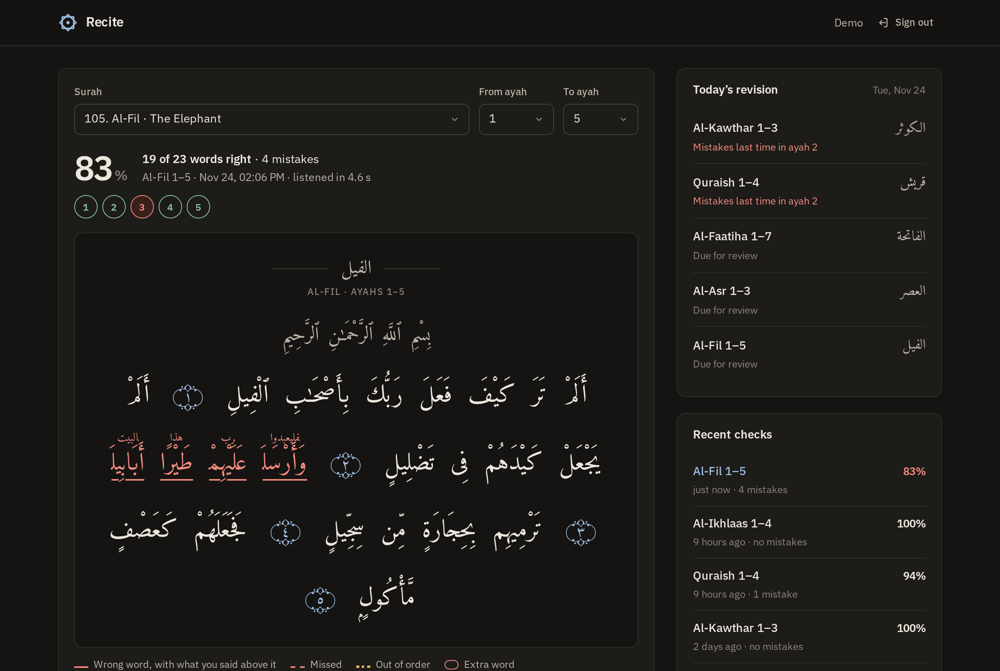
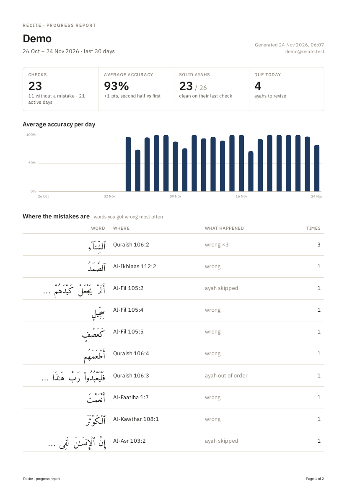

# Recite

**Recite from memory. See every word you missed.**

Recite checks a Quran recitation word by word. Record yourself reciting a passage with the text hidden. Recite marks every skipped, wrong, repeated or out-of-order word against the Quran text, and builds a daily revision plan from your own mistakes. Speech recognition runs locally with an open Quran model, so it costs nothing and recordings never leave the server.

FlyRank internship, Backend AI Engineering track, capstone *Your 10x Solution*. The overview document is [My 10x Solution - Muhammad Abdullah.md](My%2010x%20Solution%20-%20Muhammad%20Abdullah.md).



## The problem, and the 10x

When you memorise the Quran, the only real test is reciting from memory to someone who knows the passage, because reading along hides your own mistakes. That listener is a teacher you see once or twice a week. Between lessons, mistakes go unnoticed and old passages fade, because revision is unplanned.

**Getting a recitation checked goes from waiting for the next lesson (days) to about 5 seconds.** A 40-second recitation is transcribed in about 4 s on a laptop CPU (0.1× real time; see [Accuracy](#accuracy)).

## Run it

You need Docker. Then:

```bash
cp .env.example .env          # set POSTGRES_PASSWORD and JWT_SECRET in .env
docker compose up --build
```

Open **http://localhost:8000**. Sign in with the demo account **`demo@recite.test` / `demo-recite-2026`**, or create your own.

The first build takes a few minutes: it compiles whisper.cpp, installs Chromium for the PDFs and downloads the 82 MB speech model, checking its checksum. On start the API applies the database migrations, loads the Quran text and seeds the demo account. The worker builds today's revision plans straight away, so the demo has a plan the moment it opens.

## 5-minute demo path

Before you start, build some test recordings with known mistakes (this needs Python 3 and ffmpeg on your machine; it downloads public reference recitations from EveryAyah):

```bash
python3 scripts/make_samples.py     # writes samples/*.wav
```

1. **Sign in as the demo user.** On the right: *Today's revision*, the plan the daily cron built from three weeks of seeded practice (weak passages first, with the ayah that went wrong), and *Recent checks*.
2. **Check a recitation with mistakes.** Choose *105. Al-Fil*, ayahs 1–5. Click *or upload an audio file* and pick `samples/al-fil-wrong-ayah-3.wav`, in which ayah 3 was replaced by an ayah from another surah. Watch the steps (*Uploading → Waiting for the listener → Listening → Checked*). The result is **83%**: ayah 3 is red, and above each wrong word is what was actually said.
3. **Try the other slips:** `al-fil-skipped-3.wav` (ayah 3 shown as missed), `al-fil-swapped-3-4.wav` (ayah 4 out of order), `al-fil-repeated-2.wav` (100%, with ayah 2 marked as a hesitation).
4. **See the cache work.** Upload `al-fil-wrong-ayah-3.wav` again. It comes back at once, marked *instant: this exact recording was heard before*. The API answered 201 straight away instead of queueing a 202 job.
5. **Recite yourself.** Press the round button and allow the microphone. The text blurs so you recite from memory, and a live meter shows the mic is hearing you. Press stop, then *Check it*.
6. **Follow the plan.** Click a passage under *Today's revision*: it opens in the picker, ready to recite. A range is ticked off once you recite it cleanly.
7. **Get the report.** *Make PDF, last 30 days* queues a job. A few seconds later *Download PDF* appears: an accuracy chart, your most-missed words, where each surah stands and recent checks.
8. **Poke the API.** http://localhost:8000/docs lists every endpoint. `curl -i localhost:8000/attempts` returns `401`, because nothing personal is public.

## Screenshots

| Recording on a phone, text hidden | Dark mode | The PDF report ([sample](docs/report.pdf)) |
|---|---|---|
|  |  |  |

## Concepts

Six of the seven program concepts, no swaps:

| Concept | What it does here | Where |
|---|---|---|
| **API endpoints** | Auth, Quran text, attempts (audio upload), revision plan, progress, reports. Validation errors are 400 `{"error": ...}`; also 401, 404, 409, 410, 413, 415 where they apply, and 202 + `Location` for queued work | [`app/main.py`](app/main.py), [`app/routes/`](app/routes) |
| **Database** | Postgres 17 with versioned SQL migrations: users, Quran text, attempts, transcripts, ayah progress, plans, jobs, cron runs, reports | [`app/db.py`](app/db.py), [`app/migrations/`](app/migrations) |
| **Authentication** | Signup and login with argon2 password hashes and JWT bearer tokens (expiry checked). Attempts and reports are scoped to their owner; another user gets 404, so their existence isn't revealed | [`app/auth.py`](app/auth.py), [`app/routes/auth.py`](app/routes/auth.py) |
| **Background jobs + cron** | A Postgres job queue: claim with `FOR UPDATE SKIP LOCKED`, wake on `LISTEN/NOTIFY`, retry with exponential backoff, fail at once on unreadable audio, requeue jobs of crashed workers. A daily cron builds revision plans; each slot runs exactly once, and a missed slot is caught up | [`app/jobs.py`](app/jobs.py), [`app/worker.py`](app/worker.py), [`app/cron.py`](app/cron.py), [`app/revision.py`](app/revision.py) |
| **Reporting (PDF)** | "My progress" PDF built by the worker with headless Chromium, with the Arabic fonts embedded | [`app/report.py`](app/report.py), [`app/templates/report.html`](app/templates/report.html) |
| **Caching** | Transcripts cached under (SHA-256 of the audio, model). A repeat upload is scored in the API without running the model | [`app/checker.py`](app/checker.py), [`004_transcript_cache.sql`](app/migrations/004_transcript_cache.sql) |

LLM integration is left out on purpose. Recognition is done by a dedicated speech model, and the Quran text and its meaning must not be AI-generated. A test suite and a Docker Compose stack are included as well.

## How it works

```
 browser ──POST /attempts (audio)──▶ API ──┬─ same audio seen before? ──▶ score from cache ──▶ 201 done
                                           └─ else: insert attempt + job (one transaction) ──▶ 202 queued
                                                         │ NOTIFY
                                                         ▼
                        worker: ffmpeg → 16 kHz WAV → cut at pauses (≈ one ayah per piece)
                                → whisper.cpp + tarteel whisper-base-ar-quran → transcript (cached)
                                → align with the Tanzil text → wrong / missed / extra / repeat / moved
                                → per-ayah schedule (1, 3, 7, 14, 30, 60 days)
 browser ◀──GET /attempts/{id} (poll)──┘
 daily cron (worker): due ayahs → today's revision plan for every user
```

**Text.** Two Tanzil editions, both stored verbatim as their licence requires. Recordings are compared against the *simple* spelling, whose words line up with recognition output once the vowel marks are removed. People see the *Uthmani* script of the printed mushaf. The mushaf writes some phrases as one word (يا قوم → يَـٰقَوْمِ), so every simple word is mapped to the mushaf word it belongs to. A test checks this mapping for all 6,236 ayahs.

**Segmentation.** The model was trained on single ayahs, and it drops words when given long, multi-ayah audio. So recordings are cut at the reciter's pauses. The silence threshold is measured from each recording's own noise floor, and a pause must last 0.45 s, so a breath inside an ayah does not split it.

**Alignment.** A weighted edit distance with an adjacent-swap move: substitution costs slightly more than one, so a block said in the wrong place shows up as moved, not as a run of wrong words. Before aligning, immediate restarts ("…كيف فعل، كيف فعل ربك…") are lifted out as hesitations, unless the text itself repeats those words (دَكًّا دَكًّا, 89:21). The isti'adha, a basmala before the surah, and "sadaqa Allahu al-azim" at the end are ignored.

## Accuracy

`python3 scripts/make_samples.py && .venv/bin/python scripts/eval.py` runs the real pipeline on recordings built from Mishary Alafasy's per-ayah audio, with real slips cut in:

| Recording | Contains | Recite found | Accuracy | Time | |
|---|---|---|---|---|---|
| al-fil | none | none | 100% | 4.3 s | pass |
| al-fil-skipped-3 | missed in 3 | missed in 3 | 83% | 3.4 s | pass |
| al-fil-swapped-3-4 | moved in 4 | moved in 4 | 83% | 4.3 s | pass |
| al-fil-repeated-2 | repeat in 2 | repeat in 2 | 100% | 5.1 s | pass |
| al-fil-wrong-ayah-3 | wrong in 3 | wrong in 3 | 83% | 4.2 s | pass |
| al-fil-stopped-early | missed in 4, missed in 5 | missed in 4, missed in 5 | 70% | 2.6 s | pass |
| quraysh | none | none | 100% | 3.3 s | pass |
| quraysh-skipped-2 | missed in 2 | missed in 2 | 76% | 2.5 s | pass |
| al-fatiha | none | none | 100% | 5.2 s | pass |
| al-fatiha-repeated-3 | repeat in 3 | repeat in 3 | 100% | 6.1 s | pass |
| al-fatiha-swapped-5-6 | moved in 6 | moved in 6 | 90% | 5.9 s | pass |
| al-ikhlas | none | none | 100% | 1.2 s | pass |
| al-ikhlas-skipped-3 | missed in 3 | missed in 3 | 73% | 1.1 s | pass |

**13/13 cases pass.** 439 s of audio checked in 49 s (0.11x real time) with whisper.cpp/ggml-tarteel-base-q8_0.bin.

These are a professional reciter's studio recordings, which is the model's best case. Your own voice, a phone mic or a noisy room will do worse. The model has not been measured on children's voices.

## Run without Docker

Needs Python 3.12+, Postgres, ffmpeg and a `whisper-cli` binary from [whisper.cpp](https://github.com/ggml-org/whisper.cpp).

```bash
python -m venv .venv && .venv/bin/pip install -r requirements.txt
.venv/bin/python -m playwright install chromium
cp .env.example .env              # point DATABASE_URL at your Postgres, WHISPER_CLI at whisper-cli
docker compose up -d db           # or use your own Postgres
./scripts/get_model.sh            # 82 MB, checksum verified
.venv/bin/python -m app.seed      # migrations, Quran text, demo account
.venv/bin/uvicorn app.main:app --port 8000 &
.venv/bin/python -m app.worker
```

`python -m app.cron revision_plan` builds today's plans by hand.

## Tests

```bash
docker compose up -d db
.venv/bin/pip install pytest httpx
.venv/bin/python -m pytest
```

50 tests run against a real Postgres database (`recite_test`, created automatically) with a fake speech recogniser. They cover the mistake classifier (every slip type, restarts, words the text itself doubles), the simple-to-Uthmani word mapping for the whole Quran, adaptive segmentation, auth (expired and forged tokens, duplicate emails, uniform login errors), ownership, upload validation, the job queue (retry, give up, permanent failure, crashed-worker recovery), the cache, spaced revision and the cron, and the reports.

## API

| Method | Path | Auth | Notes |
|---|---|---|---|
| POST | `/auth/signup` | – | `{email, password (8+), name}` → 201 + token; 409 if the email exists |
| POST | `/auth/login` | – | → 200 + token; 401 with the same message for unknown email or wrong password |
| GET | `/auth/me` | ✓ | |
| GET | `/surahs`, `/surahs/{n}` | – | Uthmani text; `Cache-Control: public, max-age=86400` |
| POST | `/attempts` | ✓ | multipart `surah, ayah_from, ayah_to, audio` (≤ 10 MB, ≤ 20 ayahs, ≤ 3 min) → 202 queued, or 201 done from the cache |
| GET | `/attempts`, `/attempts/{id}` | ✓ | own attempts only; `result` has every word with its status |
| DELETE | `/attempts/{id}` | ✓ | 204 |
| GET | `/revision/today` | ✓ | today's plan from the cron, each range marked `done` once recited cleanly |
| GET | `/progress` | ✓ | per surah: checked, solid, due |
| POST | `/reports` | ✓ | `{days: 7..365}` → 202 (a second click while one is building returns that one) |
| GET | `/reports/{id}`, `/reports/{id}/file` | ✓ | the file is 409 until ready |
| GET | `/health` | – | checks the database |

## Limits and non-goals

- **No tajweed.** Recite checks *which words* were said, not how they were pronounced.
- **Pause between ayahs.** Segmentation relies on pauses. Reciting several ayahs in one breath still works, but long unbroken stretches are harder for the model.
- **Not a mobile app.** It is a web page, and it works in a phone browser.
- **Recognition is not perfect.** An unclear word can be marked wrong when it was right. The *What Recite heard* section under each result shows the raw transcript, so you can judge for yourself.

## Future ideas

Live feedback while reciting; per-letter and harakat-level mistakes; a memorisation mode that reveals one ayah at a time; a teacher view for a class.

## Credits and licences

- Quran text: [Tanzil Project](https://tanzil.net), *Simple* and *Uthmani* editions, CC BY 3.0, used verbatim. The copyright notices are kept in [`data/`](data).
- Speech model: [tarteel-ai/whisper-base-ar-quran](https://huggingface.co/tarteel-ai/whisper-base-ar-quran) by Tarteel AI, Apache-2.0, converted to ggml (see [`models/README.md`](models/README.md)). It runs on [whisper.cpp](https://github.com/ggml-org/whisper.cpp) (MIT).
- Fonts: [Amiri and Amiri Quran](https://github.com/aliftype/amiri) and [IBM Plex Sans](https://github.com/IBM/plex), SIL Open Font License (license texts in [`app/static/fonts/`](app/static/fonts)).
- Sample recordings: Mishary Alafasy via [EveryAyah](https://everyayah.com). They are downloaded by the script, not redistributed.
- Surah names and ayah counts: [AlQuran.cloud](https://alquran.cloud) API.
