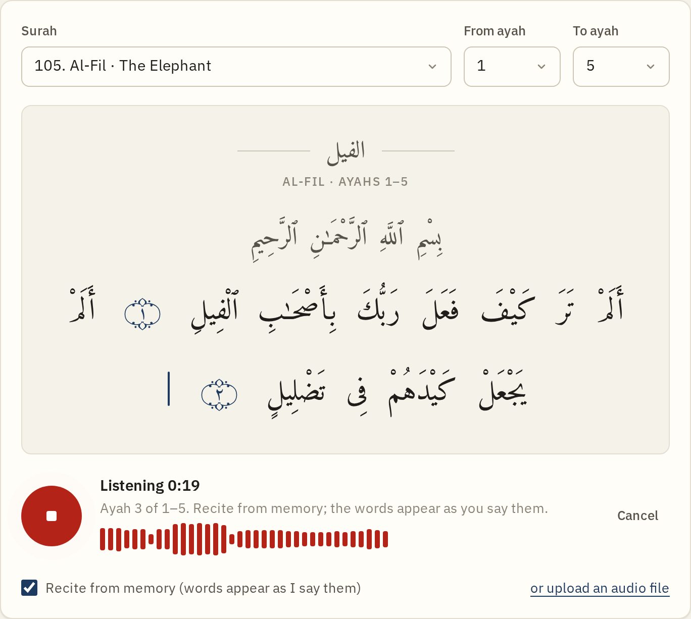
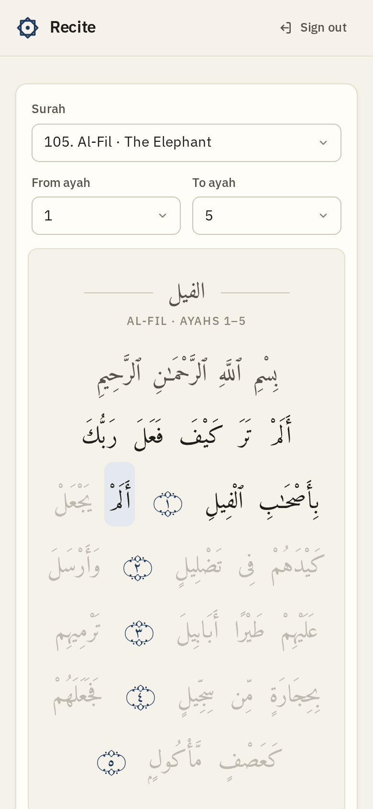

# Recite

**Recite from memory. Every word is checked as you say it.**

Recite checks a Quran recitation word by word, while you recite. Press the button and recite a passage from memory: the words appear as you say them, and a skipped, wrong, repeated or out-of-order word is marked on the spot. Every check feeds a daily revision plan built from your own mistakes. Speech recognition runs locally with an open Quran model, so it costs nothing and recordings never leave the server.

FlyRank internship, Backend AI Engineering track, capstone *Your 10x Solution*. The overview document is [My 10x Solution - Muhammad Abdullah.md](My%2010x%20Solution%20-%20Muhammad%20Abdullah.md).


## The problem, and the 10x

When you memorise the Quran, the only real test is reciting from memory to someone who knows the passage, because reading along hides your own mistakes. That listener is a teacher you see once or twice a week. Between lessons, mistakes go unnoticed and old passages fade, because revision is unplanned.

**Getting a recitation checked goes from waiting for the next lesson (days) to while you recite.** Words appear about half a second to a second after you say them, a mistake is marked about 2 s after you pause, and the full result is there about 2–3 s after the last word, on a laptop CPU (see [Accuracy](#accuracy)).

## Run it

You need Docker. Then:

```bash
cp .env.example .env          # set POSTGRES_PASSWORD and JWT_SECRET in .env
docker compose up --build
```

Open **http://localhost:8000**. Sign in with the demo account **`demo@recite.test` / `demo-recite-2026`**, or create your own.

The first build takes a few minutes: it compiles whisper.cpp, installs Chromium for the PDFs and downloads the two speech models (346 MB), checking their checksums. On start the API applies the database migrations, loads the Quran text and seeds the demo account. The worker builds today's revision plans straight away, so the demo has a plan the moment it opens.

## 5-minute demo path

Before you start, build some test recordings with known mistakes (this needs Python 3 and ffmpeg on your machine; it downloads public reference recitations from EveryAyah):

```bash
python3 scripts/make_samples.py     # writes samples/<reciter>/*.wav, 10 reciters
```

1. **Sign in as the demo user.** On the right: *Today's revision*, the plan the daily cron built from three weeks of seeded practice (weak passages first, with the ayah that went wrong), and *Recent checks*.
2. **Recite.** Choose *105. Al-Fil*, ayahs 1–5, press the round button (or Space) and allow the microphone. Recite from memory: the words appear as you say them, and the marker shows where the next word goes. Skip an ayah and it turns up as missed as soon as you go on to the next one. After the last word the check finishes by itself and shows the result. Untick *Recite from memory* to see the whole passage with the word you are on highlighted.
3. **Check a recording with mistakes.** Click *or upload an audio file* and pick `samples/alafasy/al-fil-wrong-ayah-3.wav`, in which ayah 3 was replaced by an ayah from another surah. Uploads go through the job queue: watch the steps (*Uploading → Waiting for the listener → Listening → Checked*). The result is **83%**: ayah 3 is red, and above each wrong word is what was actually said.
4. **Try the other slips and other reciters:** `al-fil-skipped-3.wav` (ayah 3 shown as missed), `al-fil-swapped-3-4.wav` (ayah 4 out of order), `al-fil-restart-3.wav` (100%: the reciter stops halfway through ayah 3 and starts it again, which is noted with ↺ but is not a mistake). Each of the ten folders in `samples/` is a different reciter.
5. **See the cache work.** Upload `al-fil-wrong-ayah-3.wav` again. It comes back at once, marked *instant: this exact recording was heard before*. The API answered 201 in about 25 ms instead of queueing a 202 job that takes about 5 s.
6. **Follow the plan.** Click a passage under *Today's revision*: it opens in the picker, ready to recite. A range is ticked off once you recite it cleanly.
7. **Get the report.** *Make PDF, last 30 days* queues a job. A few seconds later *Download PDF* appears: an accuracy chart, your most-missed words, where each surah stands and recent checks.
8. **Poke the API.** http://localhost:8000/docs lists every endpoint. `curl -i localhost:8000/attempts` returns `401`, because nothing personal is public.

## Screenshots

| Reciting from memory: the words appear as they are said; ayah 3 was skipped, so it stays open | Reciting on a phone | Dark mode | The PDF report ([sample](docs/report.pdf)) |
|---|---|---|---|
|  |  |  |  |

## Concepts

Six of the seven program concepts, no swaps:

| Concept | What it does here | Where |
|---|---|---|
| **API endpoints** | Auth, Quran text, attempts (audio upload), revision plan, progress, reports, and a WebSocket, `/live`, that takes microphone audio in and sends each word's status back while you recite. Validation errors are 400 `{"error": ...}`; also 401, 404, 409, 410, 413, 415 where they apply, and 202 + `Location` for queued work | [`app/main.py`](app/main.py), [`app/routes/`](app/routes), [`app/live.py`](app/live.py) |
| **Database** | Postgres 17 with versioned SQL migrations: users, Quran text, attempts, transcripts, ayah progress, plans, jobs, cron runs, reports | [`app/db.py`](app/db.py), [`app/migrations/`](app/migrations) |
| **Authentication** | Signup and login with argon2 password hashes and JWT bearer tokens (expiry checked). Attempts and reports are scoped to their owner; another user gets 404, so their existence isn't revealed | [`app/auth.py`](app/auth.py), [`app/routes/auth.py`](app/routes/auth.py) |
| **Background jobs + cron** | Uploads and PDFs go through a Postgres job queue: claim with `FOR UPDATE SKIP LOCKED`, wake on `LISTEN/NOTIFY`, retry with exponential backoff, fail at once on unreadable audio, requeue jobs of crashed workers. A daily cron builds revision plans; each slot runs exactly once, and a missed slot is caught up | [`app/jobs.py`](app/jobs.py), [`app/worker.py`](app/worker.py), [`app/cron.py`](app/cron.py), [`app/revision.py`](app/revision.py) |
| **Reporting (PDF)** | "My progress" PDF built by the worker with headless Chromium, with the Arabic fonts embedded | [`app/report.py`](app/report.py), [`app/templates/report.html`](app/templates/report.html) |
| **Caching** | Transcripts cached under (SHA-256 of the audio, model). A repeat upload is scored in the API without running the model. A live check stores its transcript there too, so uploading that recording later is instant | [`app/checker.py`](app/checker.py), [`004_transcript_cache.sql`](app/migrations/004_transcript_cache.sql) |

LLM integration is left out on purpose. Recognition is done by a dedicated speech model, and the Quran text and its meaning must not be AI-generated. A test suite and a Docker Compose stack are included as well.

## How it works

```
 LIVE  browser mic → AudioWorklet (16 kHz PCM, 100 ms chunks) ══WebSocket /live══▶ API
         phrase being said: fast model every ~0.35 s → confirms the words that match, in order ─┐
         pause (0.4 s): phrase closed → accurate model, passage as context → final text ────────┤
                                    align the final texts with the start of the passage
       browser ◀══ each word: correct / wrong / missed / moved / current / pending ════════════┘
         stop, or the whole passage said → cut the recording exactly as an upload would be,
         reuse the live phrases that match, recognise the rest → score, save, cache → result

 UPLOAD
 browser ──POST /attempts (audio)──▶ API ──┬─ same audio seen before? ──▶ score from cache ──▶ 201 done
                                           └─ else: insert attempt + job (one transaction) ──▶ 202 queued
                                                         │ NOTIFY
                                                         ▼
                        worker: ffmpeg → 16 kHz WAV → cut at pauses (≈ one ayah per piece)
                                → whisper.cpp, Quran Whisper small, passage as context → transcript (cached)
                                → align with the Tanzil text → wrong / missed / extra / repeat / moved
                                → per-ayah schedule (1, 3, 7, 14, 30, 60 days)
 browser ◀──GET /attempts/{id} (poll)──┘
 daily cron (worker): due ayahs → today's revision plan for every user
```

**Text.** Two Tanzil editions, both stored verbatim as their licence requires. Recordings are compared against the *simple* spelling, whose words line up with recognition output once the vowel marks are removed. People see the *Uthmani* script of the printed mushaf. The mushaf writes some phrases as one word (يا قوم → يَـٰقَوْمِ), so every simple word is mapped to the mushaf word it belongs to. A test checks this mapping for all 6,236 ayahs.

**Segmentation.** Speech models drop words when given long, multi-ayah audio, so recordings are cut at the reciter's pauses. The silence threshold is measured from each recording's own noise floor (between the first and the last sound, so waiting before you start or pressing stop late does not skew it), and a pause must last 0.45 s, so a breath inside an ayah does not split it. A "phrase" whose loudest moment stays 15 dB under the voice is a breath, a chair or a click, and is dropped before the model can make up words for it.

**Recognition.** Two open Quran models run locally on whisper.cpp ([`models/README.md`](models/README.md)). Every decision comes from *Whisper small fine-tuned on recitations by many reciters* (Tarbiyah-ai, MIT). Before each phrase it is given the passage text around where the reciter has got to, as a listener who knows the surah would have it: that settles words it half-heard, but it still writes what it hears, so a skipped or wrong ayah stays wrong. A faster, smaller model (Tarteel's whisper-base) is used only to follow along live inside the phrase being said; it never marks a word wrong. Text that cannot fit in the audio (more than three words a second, e.g. a made-up sentence for an "āmīn" or a cough) is thrown away.

**Live.** The same cutting happens on the stream as it arrives, with two differences, because only the audio so far is known. The threshold starts from an assumed quiet room and settles as you recite; when a phrase ends it is checked once more for pauses the early threshold missed. And the phrase you are still saying is looked at every ~0.35 s by the fast model with a shortened window: the words it heard that match the passage, in order from where you are, appear straight away; anything else waits. When you pause, the accurate model decides that phrase, and only then can a word turn wrong or missed, so marks never flicker. The two run side by side, so the next phrase keeps appearing while the last one is decided. The final texts are aligned with the *start* of the passage, so words you have not reached are pending, not missed, and a skipped ayah is marked as soon as the words after it are recognised. The stored result does not depend on any of that: on stop, the recording is cut exactly as an upload would be, live phrases cut the same way are reused, and only the others are recognised again, so a live check and an upload of the same audio give the same result.

**Matching words.** Recite checks which words were said, not how they were pronounced, so words are compared without vowel marks and with these differences ignored: mushaf versus modern spelling (ٱلْعَٰلَمِينَ = العالمين, ٱلصَّلَوٰةَ = الصلاة); "al" before a sun letter written as said (ٱلرَّحْمَٰنِ heard as "ar-rahman"); the silent alef of "al" after a vowel (اهدنا الصراط, heard as "ihdinas-sirat"); letters that sound alike and that the model confuses (ض ظ, ذ ز, ص س ث, ط ت د, ح ه, ق ك, غ خ); and one letter heard differently inside a long word (المغضوب heard as المخبوب). Not ignored: a different first or last letter, which is where a different word form shows (يعلمون / تعلمون, عليه / عليهم), and different short words (قال / قل). The opening letters of a surah (الم) are matched however the model spells the letter names.

**Alignment.** A weighted edit distance with an adjacent-swap move: substitution costs slightly more than one, so a block said in the wrong place shows up as moved, not as a run of wrong words.

**Going back is not a mistake.** When you stop and say part of the passage again (to fix a word, or to restart an ayah), the attempt you went back over is noted with ↺, and the *last* attempt is what is checked, so a word you corrected counts as correct. The two attempts may be heard slightly differently, and the first may stop mid-word; both are still recognised as going back. It is shown as a hesitation and does not make the ayah weak or bring it back for revision. Words the text itself repeats (دَكًّا دَكًّا, 89:21) are not taken for going back. The isti'adha, a basmala before the surah, and "āmīn" or "sadaqa Allahu al-azim" at the end are ignored.

## Accuracy

`python3 scripts/make_samples.py && .venv/bin/python scripts/eval.py` builds 150 recordings with known slips from ten reciters' per-ayah audio (15 per reciter: clean recitations, a skipped ayah, two ayahs swapped, an ayah repeated, a restart halfway through an ayah, a wrong ayah, stopping early) and runs the real pipeline on them. A recording passes when Recite reports exactly the slips it contains, no more and no fewer. `--dump` saves every transcript, so alignment changes can be re-scored in seconds without recognising again.

| Reciter | Style | First version (one model) | Now |
|---|---|---|---|
| Mishary Alafasy | modern, clear | 14/15 | 14/15 |
| Mahmoud Khalil al-Husary | slow, measured | 9/15 | 13/15 |
| Mohamed Siddiq al-Minshawi | slow, measured | 14/15 | 15/15 |
| Abdul Basit (mujawwad) | melodic, long elongations | 15/15 | 14/15 |
| Abdurrahman al-Sudais | fast, compressed studio sound | 2/15 | 2/15 |
| Saad al-Ghamdi | fast | 11/15 | 11/15 |
| Muhammad Ayyoub | measured | 14/15 | 15/15 |
| Maher al-Muaiqly | fast | 5/15 | 8/15 |
| Shahriar Parhizgar | Iranian, repeats phrases | 2/15 | 7/15 |
| Karim Mansoori | Iranian | 9/15 | 11/15 |
| **All** | | **95/150** | **110/150** |

**A non-professional voice.** Two recitations by a non-professional reciter on a laptop microphone (Al-Fatiha and Al-Baqarah 1–5) went from 76% and 83% of words right to 97% and 92%. The words still marked are ones the models heard differently (بِسْمِ heard as "ism"); judging from the transcripts they were recited correctly. That is the case that matters most, and it is where the first version did worst: the old model was trained on these same professional reciters, which flattered it on them.

**Where it is still weak.** Sudais' recordings defeat both models (fast, heavily compressed audio). On fast reciters generally, two ayahs said with almost no pause between them can arrive as one phrase, and the models then drop words. These are studio recordings of professionals; a person reciting at home pauses more.

**Live.** `.venv/bin/python scripts/eval.py --live` streams each recording through the WebSocket path in real time, 100 ms at a time, like the page does. On Alafasy, Sudais and Parhizgar (45 recordings) it finds exactly what an upload finds (23/45 on these three, the hardest two included), and the marks on screen when the reciter stops are already the final ones. The quick looks that make the words appear cover audio 0.24 s old (median; 90% within 0.43 s). Played in real time, a non-professional recording of Al-Fatiha had each ayah's words on screen while the ayah was still being said, and each phrase decided about 2.2 s after the pause (see the `recite.live` lines in the server log).

The models have not been measured on children's voices.

## Run without Docker

Needs Python 3.12+, Postgres, ffmpeg and a `whisper-cli` binary from [whisper.cpp](https://github.com/ggml-org/whisper.cpp).

```bash
python -m venv .venv && .venv/bin/pip install -r requirements.txt
.venv/bin/python -m playwright install chromium
cp .env.example .env              # point DATABASE_URL at your Postgres, WHISPER_CLI at whisper-cli
docker compose up -d db           # or use your own Postgres
./scripts/get_model.sh            # the two models, 346 MB, checksums verified
.venv/bin/python -m app.seed      # migrations, Quran text, demo account
.venv/bin/uvicorn app.main:app --port 8000 &
.venv/bin/python -m app.worker
```

`python -m app.cron revision_plan` builds today's plans by hand.

With a GPU, build whisper.cpp with `-DGGML_VULKAN=ON` (or CUDA/Metal) and point `WHISPER_CLI` at it: each check is about twice as fast. `WHISPER_SERVER` (resident models that judge every word while it is said) is experimental.

## Tests

```bash
docker compose up -d db
.venv/bin/pip install pytest httpx
.venv/bin/python -m pytest
```

80 tests run against a real Postgres database (`recite_test`, created automatically) with a fake speech recogniser. They cover the mistake classifier (every slip type, going back and restarts heard slightly differently, words the text itself doubles, what counts as the same word and what does not, and 2,000 random messy recitations that must never break it), the simple-to-Uthmani word mapping for the whole Quran, adaptive segmentation, auth (expired and forged tokens, duplicate emails, uniform login errors), ownership, upload validation, the job queue (retry, give up, permanent failure, crashed-worker recovery), the cache, spaced revision and the cron, the reports, and live checking (phrases cut from a stream, words marked while reciting, the end detected, the WebSocket protocol, auth and errors on it, and that a live check and an upload of the same audio agree).

## API

| Method | Path | Auth | Notes |
|---|---|---|---|
| POST | `/auth/signup` | – | `{email, password (8+), name}` → 201 + token; 409 if the email exists |
| POST | `/auth/login` | – | → 200 + token; 401 with the same message for unknown email or wrong password |
| GET | `/auth/me` | ✓ | |
| GET | `/surahs`, `/surahs/{n}` | – | Uthmani text; `Cache-Control: public, max-age=86400` |
| POST | `/attempts` | ✓ | multipart `surah, ayah_from, ayah_to, audio` (≤ 10 MB, ≤ 20 ayahs, ≤ 3 min) → 202 queued, or 201 done from the cache |
| GET | `/attempts`, `/attempts/{id}` | ✓ | own attempts only; `result` has every word with its status |
| DELETE | `/attempts/{id}` | ✓ | 204 |
| GET | `/revision/today` | ✓ | today's plan from the cron, each range marked `done` once recited cleanly |
| GET | `/progress` | ✓ | per surah: checked, solid, due |
| POST | `/reports` | ✓ | `{days: 7..365}` → 202 (a second click while one is building returns that one) |
| GET | `/reports/{id}`, `/reports/{id}/file` | ✓ | the file is 409 until ready |
| WS | `/live` | token in first message | `{"type":"start", token, surah, ayah_from, ayah_to}`, then binary 16 kHz mono 16-bit PCM, then `{"type":"stop"}`. The server sends `ready` (the passage's words), `progress` (every word's status) after each recognition pass, `complete` when the whole passage was said, and finally `result` (the saved attempt). Errors: `{"type":"error", status, error}` |
| GET | `/health` | – | checks the database |

## Limits and non-goals

- **No tajweed.** Recite checks *which words* were said, not how they were pronounced.
- **Pause between ayahs.** Segmentation relies on pauses. Reciting several ayahs in one breath still works, but long unbroken stretches are harder for the model, and live the words of a long phrase appear a little later.
- **Live needs the server close by.** The page streams about 32 KB/s of audio. On a slow connection, use the upload instead.
- **Not a mobile app.** It is a web page, and it works in a phone browser.
- **Recognition is not perfect.** An unclear word can be marked wrong when it was right. The *What Recite heard* section under each result shows the raw transcript, so you can judge for yourself.

## Future ideas

Per-letter and harakat-level mistakes; a memorisation mode that reveals one ayah at a time; a teacher view for a class.

## Credits and licences

- Quran text: [Tanzil Project](https://tanzil.net), *Simple* and *Uthmani* editions, CC BY 3.0, used verbatim. The copyright notices are kept in [`data/`](data).
- Speech models: [Habib-HF/tarbiyah-ai-v1-1](https://huggingface.co/Habib-HF/tarbiyah-ai-v1-1) (Whisper small fine-tuned on Quran recitations, MIT) and [tarteel-ai/whisper-base-ar-quran](https://huggingface.co/tarteel-ai/whisper-base-ar-quran) by Tarteel AI (Apache-2.0), converted to ggml (see [`models/README.md`](models/README.md)). It runs on [whisper.cpp](https://github.com/ggml-org/whisper.cpp) (MIT).
- Fonts: [Amiri and Amiri Quran](https://github.com/aliftype/amiri) and [IBM Plex Sans](https://github.com/IBM/plex), SIL Open Font License (license texts in [`app/static/fonts/`](app/static/fonts)).
- Sample recordings: ten reciters via [EveryAyah](https://everyayah.com) (Alafasy, Husary, Minshawi, Abdul Basit, Sudais, Ghamdi, Muhammad Ayyoub, Maher al-Muaiqly, Parhizgar, Karim Mansoori). They are downloaded by the script, not redistributed.
- Surah names and ayah counts: [AlQuran.cloud](https://alquran.cloud) API.
